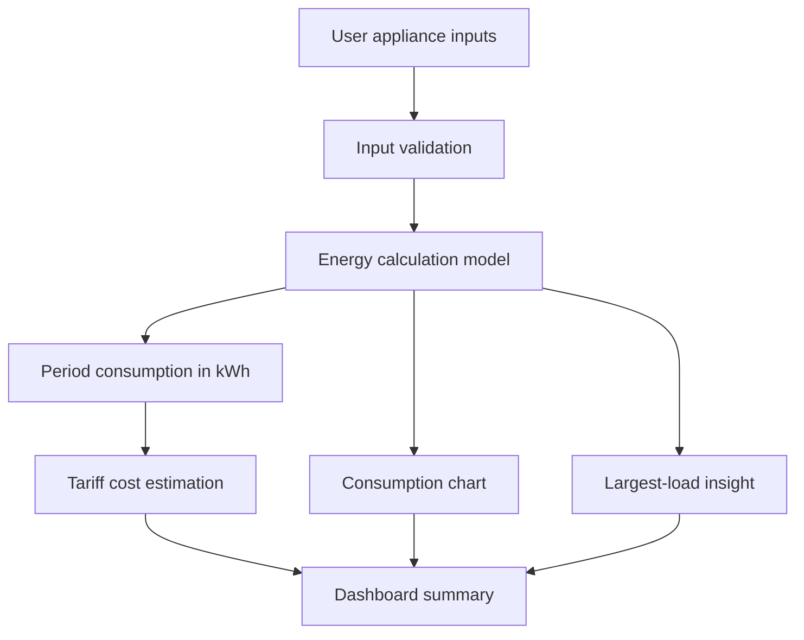

# SmartWatt — Energy Intelligence

**SmartWatt** is a lightweight, browser-based energy estimation dashboard that turns appliance-level power and operating-hour assumptions into estimated electricity consumption and cost. It is designed as an Electrical Engineering portfolio project with transparent calculations and clear limitations.

> **Prototype scope:** this version uses locally entered/example data. It does not connect to a smart meter, IoT sensor, utility billing system, or cloud service. Example appliance values are illustrative, not measured data.

## Highlights

- Appliance-level energy estimation using rated power, usage hours, quantity, and analysis-period days.
- Flat-rate electricity cost estimation with an editable tariff.
- Interactive consumption chart and largest-load insight.
- Add, edit, and remove appliances.
- Responsive layout and keyboard-visible focus states.
- Input validation and clear estimation assumptions.
- Dependency-free front end using HTML, CSS, and JavaScript.
- Automated tests for the core energy calculation.

## Calculation model

For appliance \(i\):

\[
E_i\;(kWh)=\frac{P_i\;(W)\times t_i\;(h/day)\times n_i\times d\;(days)}{1000}
\]

Total estimated energy:

\[
E_{total}=\sum_{i=1}^{N} E_i
\]

Flat-rate estimated cost:

\[
C_{estimated}=E_{total}\times R
\]

where \(R\) is the assumed tariff in currency per kWh.

### Assumptions and limitations

- Rated power is treated as constant during the entered operating hours.
- The model does not represent compressor cycling, variable-speed drives, standby consumption, power factor, demand charges, tariff slabs, taxes, fixed charges, or utility-specific billing rules.
- Cost output is an estimate, not an official bill.
- Energy reduction or savings are not claimed because no measured baseline or intervention data is included.
- The sample appliance list is illustrative and should be replaced with values appropriate to the intended site.

## Run locally

### Option A — open directly
Open `index.html` in a modern browser. No build step is required.

### Option B — local static server
With Python installed, run this command from the project directory:

```bash
python -m http.server 8000
```

Then visit `http://localhost:8000`.

## Tests

Node.js 18 or later is required for the built-in test runner:

```bash
npm test
```

Or run directly:

```bash
node --test tests/energy.test.js
```

The tests cover a normal calculation, quantity and period scaling, zero operating time, fractional inputs, negative inputs, invalid hours, and non-finite inputs.

## Project structure

```text
smartwatt-energy-intelligence/
├── index.html
├── styles.css
├── app.js
├── package.json
├── README.md
├── LICENSE
├── .gitignore
├── CONTRIBUTING.md
├── CHANGELOG.md
└── tests/
    └── energy.test.js
```

## Architecture



The interface, input handling, calculation logic, and presentation are kept in a small vanilla JavaScript application. The calculation function is isolated and exported for testing in Node.js.

## GitHub Pages deployment

1. Create a public GitHub repository named `smartwatt-energy-intelligence`.
2. Upload the project files to the repository root.
3. Open **Settings → Pages**.
4. Under the build/deployment section, choose **Deploy from a branch**.
5. Select `main` and `/ (root)`, then save.
6. Wait for GitHub Pages to publish and open the URL shown in the Pages settings.
7. Verify the dashboard, CSS, JavaScript, appliance edits, and cost calculations on the published URL.

Do not add API keys or private data. This project currently has no backend secrets.

## Roadmap

- Add configurable tariff slabs with clearly cited local tariff assumptions.
- Import/export appliance scenarios as JSON or CSV.
- Compare baseline and proposed scenarios using user-supplied assumptions.
- Integrate real smart-meter/IoT measurements only after selecting and validating suitable hardware and data protocols.
- Add timestamped data storage and time-series analysis if the project scope expands beyond a static browser prototype.

## Engineering integrity

The project intentionally distinguishes **estimated** consumption from **measured** consumption. Future integrations should document sensor accuracy, sampling intervals, calibration, data quality, and validation methodology before describing results as real-world measurements.
